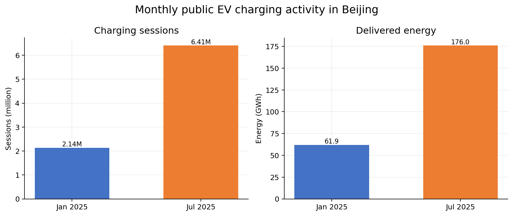
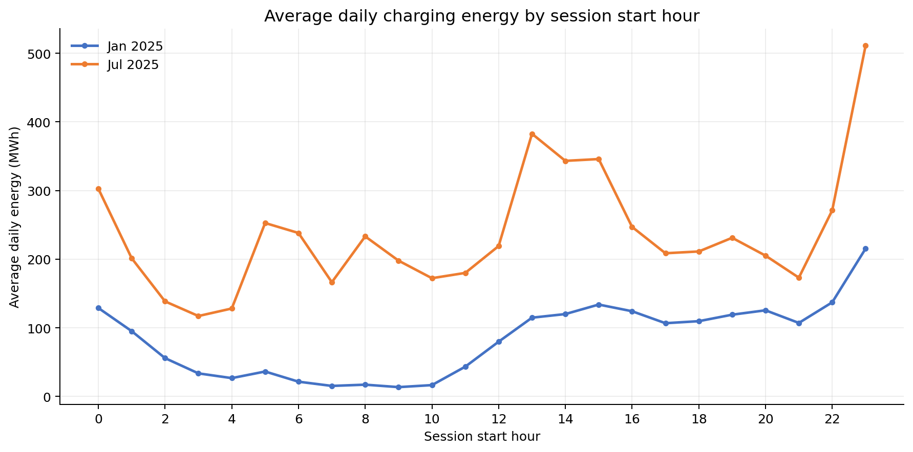
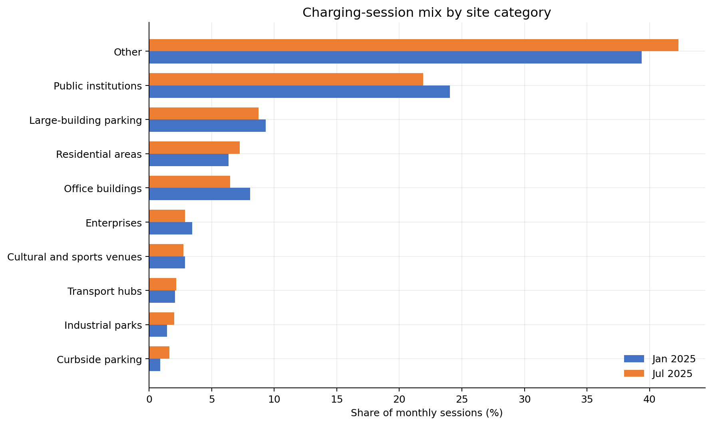
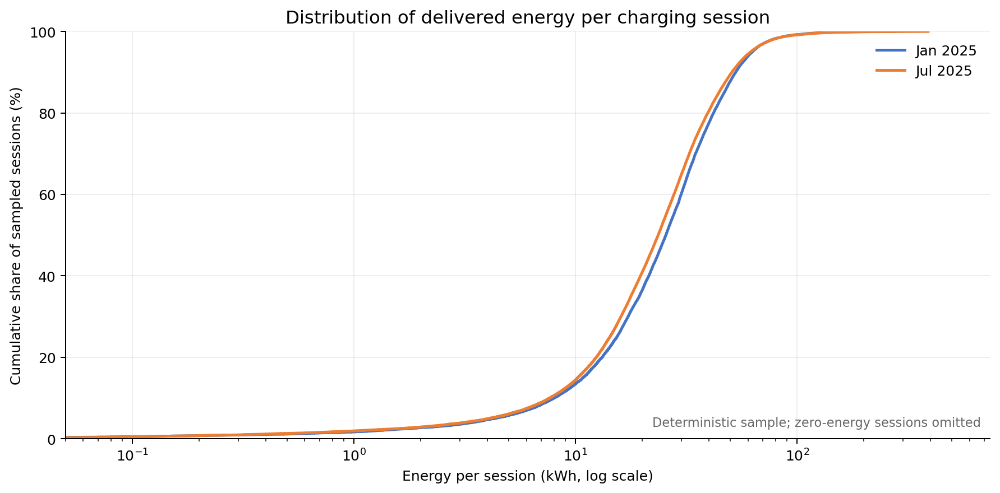
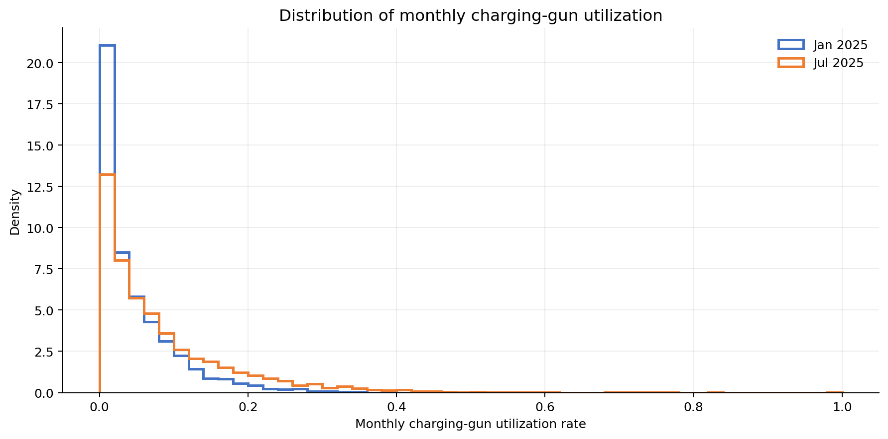

# 北京公共电动车充电数据分析

本项目用于分析北京市公共电动车充电交易及充电基础设施数据，当前处于数据检查和探索性可视化准备阶段。

## 数据来源

- 论文：*A city-scale dataset of public electric vehicle charging transactions and infrastructure*
- Figshare DOI：https://doi.org/10.6084/m9.figshare.31952289.v1
- 时间范围：2025年1月和2025年7月
- 数据许可：以Figshare数据页面标注的许可为准

原始数据保存在本地 `data/raw/`，不会提交到Git仓库，也不应被直接修改。清洗或转换后的数据应写入 `data/processed/`。

## 当前数据文件

| 文件 | 行数 | 列数 | 说明 |
| --- | ---: | ---: | --- |
| `orders_2025-01_public.parquet` | 2,137,234 | 11 | 2025年1月充电订单 |
| `orders_2025-07_public.parquet` | 6,407,461 | 11 | 2025年7月充电订单 |
| `stations_monthly_public.parquet` | 14,307 | 13 | 月度站点/网格汇总信息 |

两张订单表共包含8,544,695条记录。站点月表中的月度订单数和总电量与订单表汇总结果一致。

## 已知数据限制

- 公开文件没有论文中描述的 `station_id`，不能追踪同一站点的跨月变化，也不能把单笔订单连接到具体站点。
- 1月有1,179条记录缺少设备类型和充电功率。
- 场景字段同时使用“居民区”和“居住区”，跨月比较前需要统一。
- 数据中存在极端充电电量和额定功率，正式统计前需要识别并处理异常值。
- 费用关系已复核：按差额四舍五入到分检查，两个月均未发现超过1分钱的加总差异。
- 数据仅覆盖两个非连续月份，不适合推断全年连续趋势。

## 目录结构

```text
data/
  raw/          原始数据，只读使用，不提交到版本控制
  processed/    清洗或聚合后的数据，不提交到版本控制
notebooks/      探索性分析笔记
reports/
  figures/      导出的图表
src/            可复用分析脚本
```

作者提供的 `code.ipynb` 可保留在本地 `notebooks/` 作为参考，但不作为本项目代码提交。

## 环境安装

需要Python 3.11或更高版本。

```powershell
python -m venv .venv
.venv\Scripts\Activate.ps1
python -m pip install -e .
```

## 数据盘点

```powershell
python src/inspect_dataset.py
```

脚本会生成：

- `reports/data_inventory.csv`：文件级清单、行数和列数
- `reports/schema_profile.csv`：字段名、数据类型和所在文件

对于Parquet文件，盘点脚本只读取文件元数据，不会把全部交易记录载入内存。

## 初始可视化

异常核查结果见 [异常复核报告](reports/anomaly_review.md)。运行 `python src/audit_anomalies.py` 可重新生成详细核查结果。当前电量图仍包含原始异常值，待生成清洗前后对照。

运行：

```powershell
python src/create_visualizations.py
```

脚本会在 `reports/figures/` 生成5张探索性图表。原始Parquet文件只会被读取，不会被修改。

### 月度充电规模



### 每日分时充电电量



### 站点场景订单构成



### 单次充电电量分布



### 充电枪月利用率分布



