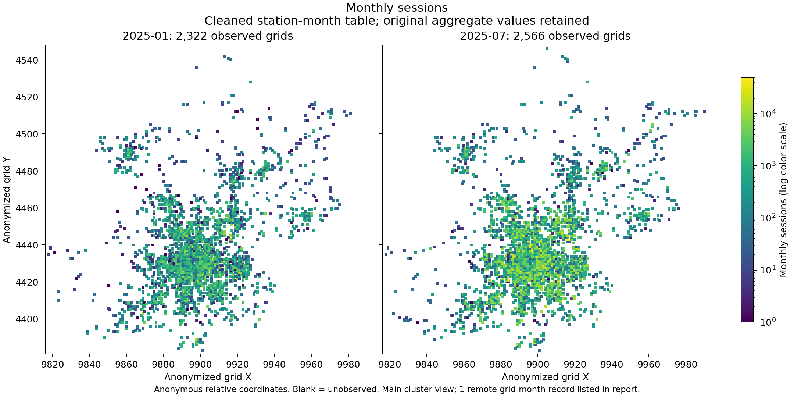
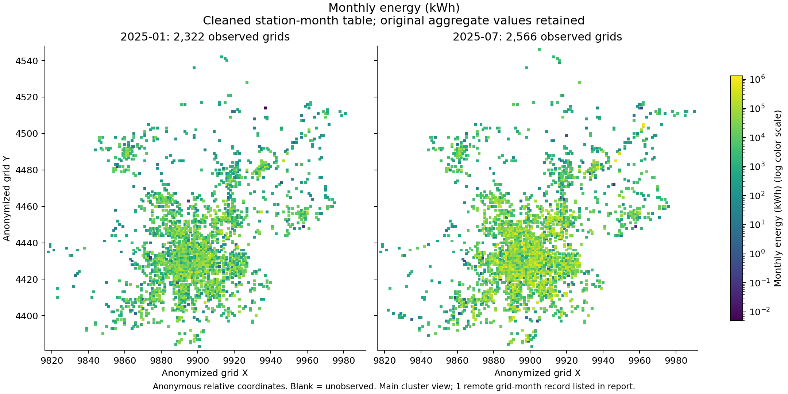
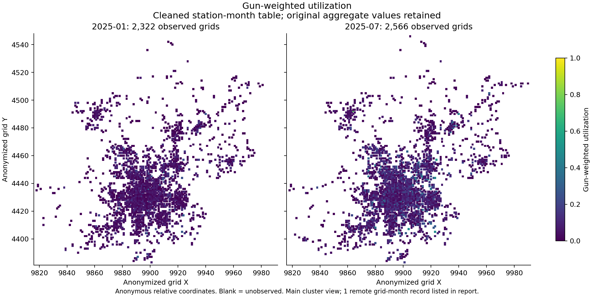
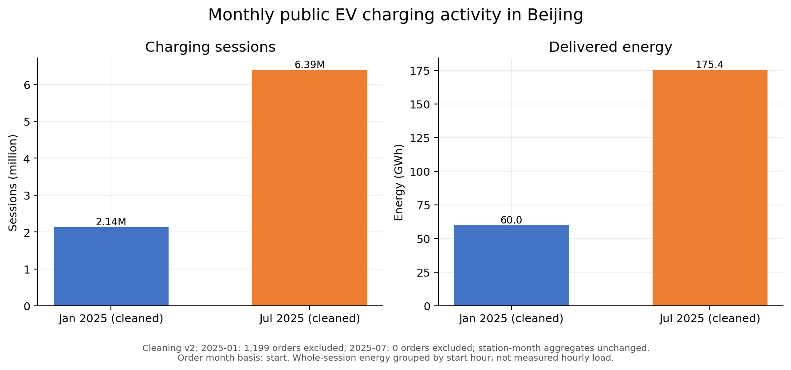
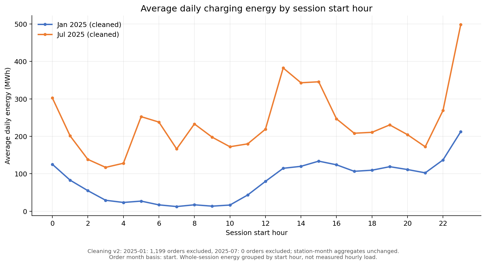
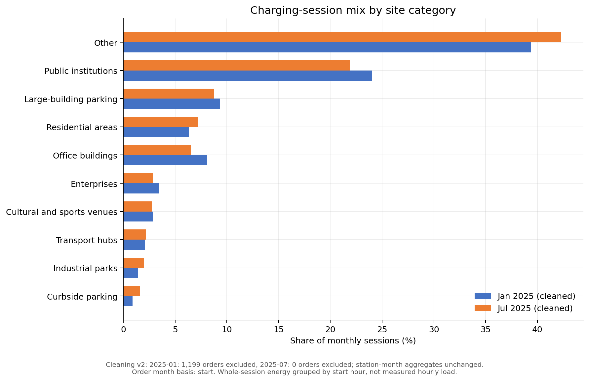
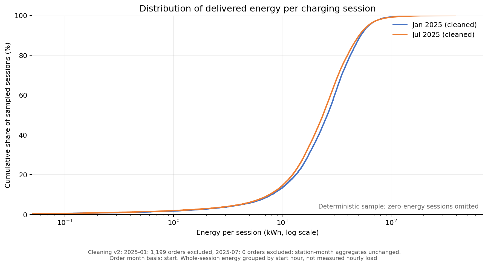
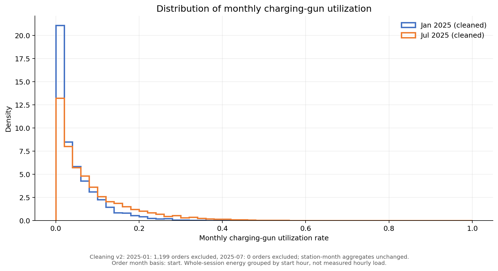

# 北京公共电动车充电数据分析

本项目用于分析北京市公共电动车充电交易及充电基础设施数据，当前处于数据检查和探索性可视化准备阶段。

## 数据来源

- 论文：*A city-scale dataset of public electric vehicle charging transactions and infrastructure*
- Figshare DOI：https://doi.org/10.6084/m9.figshare.31952289.v1
- 时间范围：2025年1月和2025年7月
- 数据许可：以Figshare数据页面标注的许可为准

原始数据保存在本地 `data/raw/`，不会提交到Git仓库，也不应被直接修改。清洗或转换后的数据应写入 `data/processed/`。

## 当前数据文件

| 文件 | 行数 | 列数 | 说明 |
| --- | ---: | ---: | --- |
| `orders_2025-01_public.parquet` | 2,137,234 | 11 | 2025年1月充电订单 |
| `orders_2025-07_public.parquet` | 6,407,461 | 11 | 2025年7月充电订单 |
| `stations_monthly_public.parquet` | 14,307 | 13 | 月度站点/网格汇总信息 |

两张订单表共包含8,544,695条记录。站点月表中的月度订单数和总电量与订单表汇总结果一致。

## 已知数据限制

- 公开文件没有论文中描述的 `station_id`，不能追踪同一站点的跨月变化，也不能把单笔订单连接到具体站点。
- 1月有1,179条记录缺少设备类型和充电功率。
- 场景字段同时使用“居民区”和“居住区”，跨月比较前需要统一。
- 数据中存在极端充电电量和额定功率，正式统计前需要识别并处理异常值。
- 费用关系已复核：按差额四舍五入到分检查，两个月均未发现超过1分钱的加总差异。
- 数据仅覆盖两个非连续月份，不适合推断全年连续趋势。

## 目录结构

```text
data/
  raw/          原始数据，只读使用，不提交到版本控制
  processed/    清洗或聚合后的数据，不提交到版本控制
notebooks/      探索性分析笔记
reports/
  figures/      导出的图表
src/            可复用分析脚本
```

作者提供的 `code.ipynb` 可保留在本地 `notebooks/` 作为参考，但不作为本项目代码提交。

## 环境安装

需要Python 3.11或更高版本。

```powershell
python -m venv .venv
.venv\Scripts\Activate.ps1
python -m pip install -e .
```

## 数据盘点

```powershell
python src/inspect_dataset.py
```

脚本会生成：

- `reports/data_inventory.csv`：文件级清单、行数和列数
- `reports/schema_profile.csv`：字段名、数据类型和所在文件

对于Parquet文件，盘点脚本只读取文件元数据，不会把全部交易记录载入内存。

## 清洗数据（当前默认第二版）

运行 `python src/clean_dataset.py`，默认生成v2结果，在 `data/processed/clean_v2_<运行时间>/` 创建新目录。v2在原极端电量规则之外，剔除设备类型或功率缺失的订单。原始文件和v1结果保持不变；`--version 1` 可复现旧规则。

- `orders_2025-01_clean.parquet`、`orders_2025-07_clean.parquet`：保留订单，统一住宅场景名称，增加原文件名、零起始原行号、开始日期和异常标记。
- `orders_2025-01_excluded.parquet`、`orders_2025-07_excluded.parquet`：保存被剔除的记录及原因。v2包括设备类型或功率缺失，以及电量超过1,000 kWh且超过记录功率×时长105%的订单；按规则并集剔除，记录重叠数量，不重复计数。
- `stations_monthly_clean.parquet`：统一场景名称；月度电量和利用率仍为上游原始汇总，不能当作清洗订单重算后的指标。
- `cleaning_manifest.json`：成功完成后的清单、行数、电量和源文件SHA-256。只有包含此文件的目录才视为完成；`failed_`目录不用于分析。

v2剔除设备类型或功率缺失的订单。跨月会话、高功率及其他容量可疑记录仍保留并标记，不做无依据插补或去重。时序分析使用 `analysis_date`，同时保留 `file_month` 和 `analysis_month` 以识别文件月份与开始月份的区别。原始 `dating_time` 保留待核实。

清洗结果保存在本地，不推送数据文件。报告清单保存为 `reports/cleaning_v<版本>_<运行时间>.json`。原始图表脚本继续读取原始数据，清洗图表脚本选择最新完成的v1或v2清洗结果。现有已生成图表不会因清洗运行而自动更新。

## 匿名网格空间分布

运行 `python src/create_spatial_visualizations.py`，从最新完成的清洗月表生成网格订单、电量和枪数加权利用率图。月份共用坐标与色标；详细汇总方法和空间离群点见 [空间图说明](reports/spatial_review.md)。月表电量仍为上游汇总，无法扣除没有网格关联键的异常订单。







## 基础图表（清洗后及原始版本）

清洗后图表运行 `python src/create_clean_visualizations.py`，默认选择最新已完成的清洗目录，并按充电开始月归属整笔订单（跨月算前一个开始月份）。`--month-basis file` 可复现文件月份口径。v2新图保存到 `reports/figures/cleaned/v2_<运行时间>/month_start/`，原始及v1图保留。当前图表已剔除缺失字段及极端电量记录，口径见 [新版图表说明](reports/cleaned_chart_review_v2_20261028T013504762238Z_month_start.md) 和 [时间字段说明](reports/time_month_policy.md)。











利用率分布及[同批次空间图](reports/figures/cleaned/v2_20261028T013504762238Z/month_start/spatial/spatial_review.md)仍来自上游站点月表，无法按订单开始月重归属，也无法扣除无关联键的剔除订单。不得把这组月表指标与订单图表称为完全相同的归月口径。

以下为原始数据版本：

异常核查结果见 [异常复核报告](reports/anomaly_review.md)。运行 `python src/audit_anomalies.py` 可重新生成详细核查结果。当前电量图仍包含原始异常值，待生成清洗前后对照。

运行：

```powershell
python src/create_visualizations.py
```

脚本会在 `reports/figures/` 生成5张探索性图表。原始Parquet文件只会被读取，不会被修改。

### 月度充电规模


### 每日分时充电电量


### 站点场景订单构成


### 单次充电电量分布


### 充电枪月利用率分布


