# 北京公共电动车充电数据分析

研究北京市公共充电设施需求与利用的网格差异，比较2025年1月和7月。当前仅使用Figshare发布版Version 2作为正式分析主线，已完成清洗、站点关联、网格重建、设施计数敏感性、共同站点比较及可观测自然月时长对照。

## 核心结果：订单增加的网格，利用率也提高了吗？

在 **2,239 个共同网格**中，**1,995 个**订单量增加，**1,958 个**总充电量增加。订单增加的网格中，**1,791 个**利用率也提高，**204 个**利用率下降。固定共同站点后，**116 个**仍是订单增加、利用率下降。

固定 **5,661 个**共同站点后，7 月比 1 月多 **267.2 万笔**订单。按开始小时看，**13 时**的订单增量最大；按日期类型看，**工作日**贡献最多；按明确命名的场所类型看，**公共机构**增量最大。

[完整分析、典型网格和分组明细](reports/grid_followup.md) · [订单量差值地图](reports/figures/source_release2/20261104T011749595890Z/grid_changes/01-orders-change-map.png) · [总充电量差值地图](reports/figures/source_release2/20261104T011749595890Z/grid_followup/01-energy-change-map.png) · [利用率差值地图](reports/figures/source_release2/20261104T011749595890Z/grid_changes/02-utilization-change-map.png)

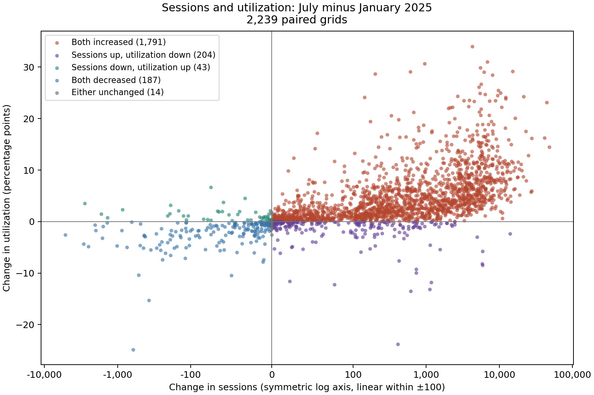

## 当前结果入口

- [项目周报文字版（已更新至第6周）](reports/项目周报.md)
- [第1至5周周报汇总](deliverables/北京市公共充电设施需求与利用的网格差异_周报汇总_连诗钰.docx)（10月5日至11月4日，连诗钰，个人项目）及[文字底稿](reports/项目周报.md)。
- [阶段总结与后续任务](reports/新版数据阶段总结与后续任务.md)
- [共同网格与共同站点冬夏比较](reports/winter_summer_comparison.md)
- [订单量与利用率差值地图及散点图](reports/grid_changes.md)
- [自然月占用时长对照](reports/calendar_month_review.md)
- [文献依据与可视化扩展方案](reports/文献参考与可视化扩展方案.md)
- [论文展示门槛与设施计数敏感性](reports/release_v2_filters_sensitivity.md)
- [阶段PPT](deliverables/北京充电数据分析_新版数据与冬夏比较_1104修订版.pptx)及[逐页讲稿](reports/新版数据_五分钟逐页讲稿.md)。PPT尚未加入后续自然月对照和新增热图。

固定共同站点后，1月、7月按开始月统计的汇总利用率为4.555%、8.975%。现有会话按自然月拆分后为4.540948%、9.008884%。这属于两个观察月份、观测活跃样本的描述性差异，不能推断完整季节因果或未满足的设施需求。

## 数据与版本

- 论文：*A city-scale dataset of public electric vehicle charging transactions and infrastructure*，DOI：[10.1038/s41597-026-07918-5](https://doi.org/10.1038/s41597-026-07918-5)。
- 数据集：[Figshare DOI](https://doi.org/10.6084/m9.figshare.31952289)，当前使用发布方Version 2，原文件保存在本地`data/redownloaded/31952289/`。
- `orders_2025-01_public.parquet`：2,137,234条订单。
- `orders_2025-07_public.parquet`：6,407,461条订单。
- `stations_public.parquet`：8,553个唯一站点。订单通过`station_id`全部关联到站点及匿名网格。

发布方Version 2与此前项目自行命名的“清洗v2”不同。旧发布版原文件仍保存在`data/raw/`以备版本核验，正式分析不再从该目录读取数据。已确认的旧版本派生数据、图表、报告与旧PPT均已清理，清单见[清理记录](reports/legacy_v1_cleanup.json)。Git中曾提交的旧内容仍可通过历史提交找回。

原始数据、ZIP、处理中间数据和论文译稿不上传仓库。译稿仅用于本地阅读，原始文件不修改。

## 处理与复现

需要Python 3.11或以上，在项目目录安装依赖：

```powershell
python -m pip install -e .
```

按以下顺序运行：

```powershell
python src/audit_release_v2.py
python src/rebuild_release_v2.py
python src/plot_release_v2.py
python src/analyze_grid_sensitivity.py
python src/compare_winter_summer.py
python src/plot_grid_changes.py
python src/analyze_grid_followup.py
python src/analyze_calendar_month.py
```

清洗和图表脚本选择有完成清单的最新运行，失败的部分输出不会进入正式分析。

当前清洗运行：`20261104T011749595890Z`，文件位于`data/processed/source_release2_clean1_20261104T011749595890Z/`，图表位于`reports/figures/source_release2/20261104T011749595890Z/`。自然月派生运行：`20261104T075413371066Z`，位于`data/processed/calendar_month_20261104T075413371066Z/`。

1月剔除20条联合极端电量记录及1,179条关键字段缺失记录，两类无重叠。正式开始月样本为1月2,136,035条、7月6,393,968条；13,493条6月开始的订单单独保留。清洗规则、哈希和分区核对见[完成清单](reports/source_release2_clean1_20261104T011749595890Z.json)。

## 图表与解释

以下展示发布版Version 2的全部18张图，分为基础分布、空间分布、论文筛选与敏感性、冬夏比较、自然月与扩展分析。点击图片可查看大图。

### 一、基础分布（5张）

**1. 月度订单量与充电量**：比较两个观察月份已实现的充电活动总量，站点覆盖范围不同。


**2. 按开始小时归类的日均电量**：将整次订单电量归到开始小时，表示到达时段对应的电量，不是实际逐小时电力负荷。

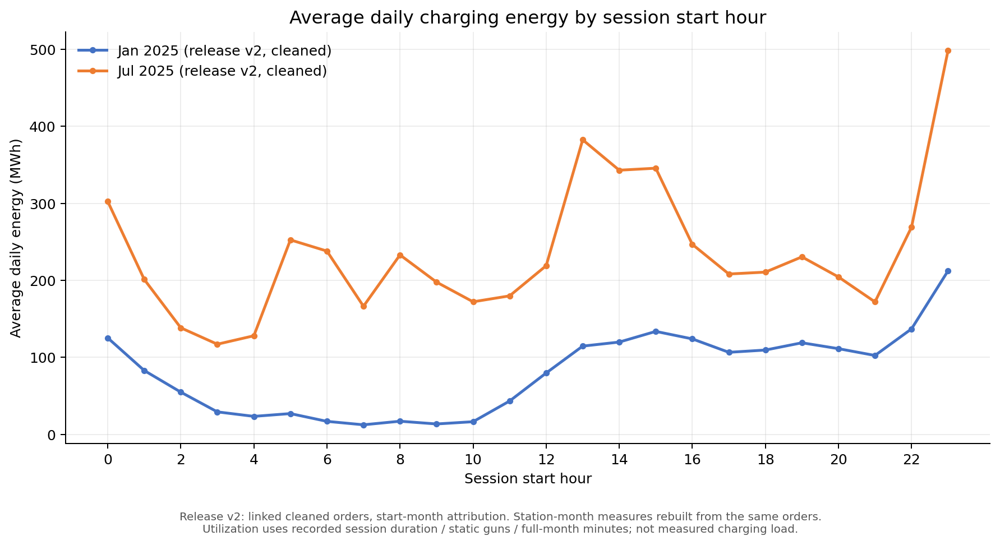

**3. 场所订单占比**：比较不同站点场所类别的订单构成。

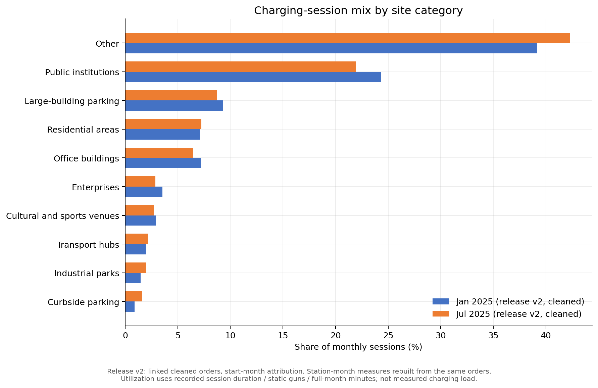

**4. 单次充电电量分布**：观察典型电量范围和长尾，图中抽样分布不代替全量统计。

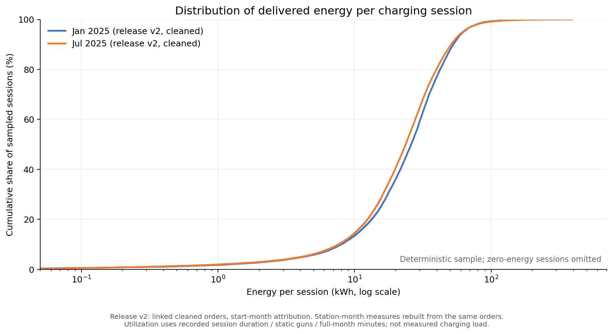

**5. 站点月利用率分布**：比较从清洗订单重建的站点利用率分布。

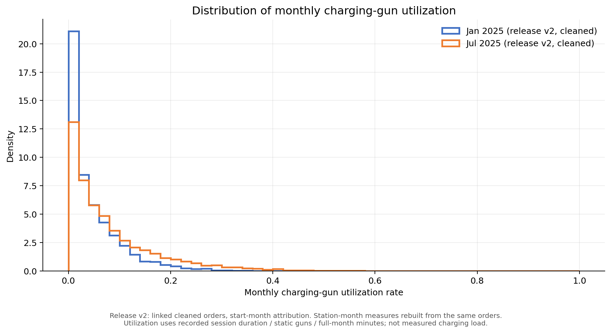

### 二、网格空间分布（3张）

基于同一批清洗订单关联站点后汇总。使用匿名相对坐标，空白代表未观测，不表示零需求。主图未展示远端网格，但完整统计保留该记录。

**6. 网格订单量空间分布**

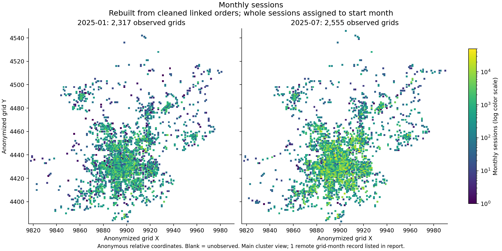

**7. 网格充电量空间分布**

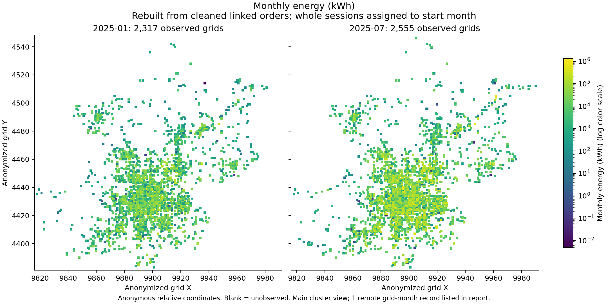

**8. 网格利用率空间分布**：两个月使用相同分段色标，便于比较低值区间。


网格利用率为记录会话时长之和／静态枪数／整月分钟数，未校正停机和重叠会话。平均单次电量与利用率展示分别使用至少5笔订单、至少5把枪的门槛，对照图独立保留。设施总分项不一致需要进一步核实，不能凭敏感性分析擅自修正原值。

### 三、论文展示筛选与设施计数敏感性（4张）

这组图单独实施论文展示门槛，基准空间图仍保留完整观测网格。详见[筛选及敏感性说明](reports/release_v2_filters_sensitivity.md)。

**9. 平均单次电量的低样本筛选对照**：门槛为至少5笔订单。共用常见范围更细的分段色标，灰叉标出筛掉的网格，保留网格的均值不变。

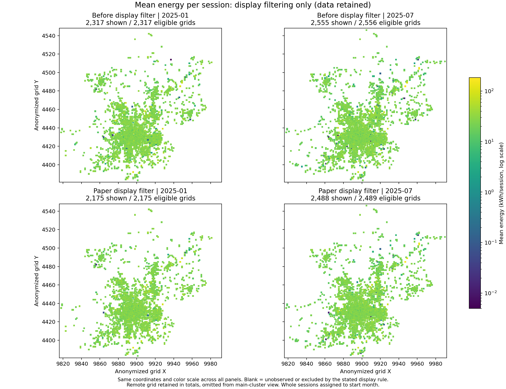

**10. 利用率的低样本筛选对照**：筛选前后比较，门槛为至少5把枪。

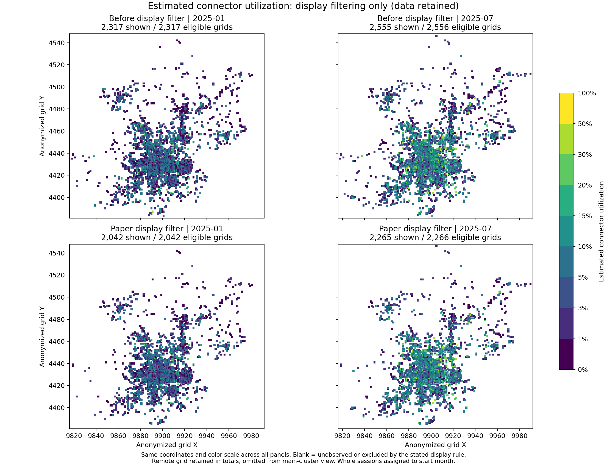

**11. 平均单次电量的设施计数敏感性**：比较保留与排除设施总分项不一致站点的结果，与图9使用同一色标，黑色空心圈标出均值发生变化的网格。

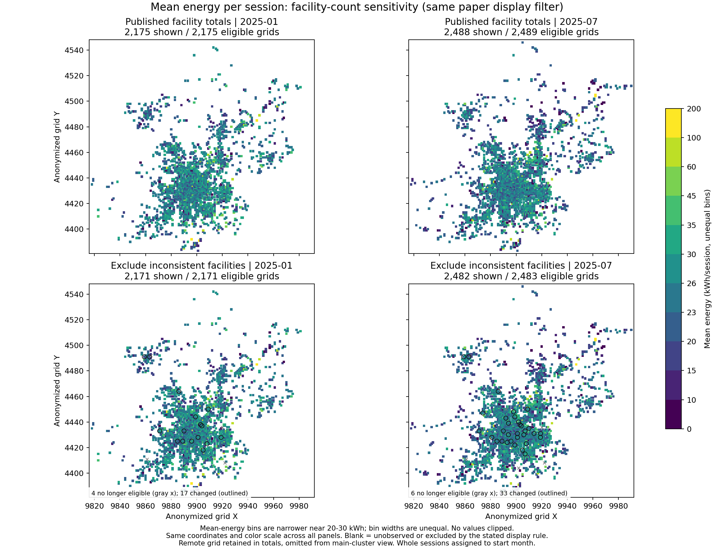

**12. 利用率的设施计数敏感性**：排除站点同时改变时长和枪数，不据此判定哪一项原始计数正确。

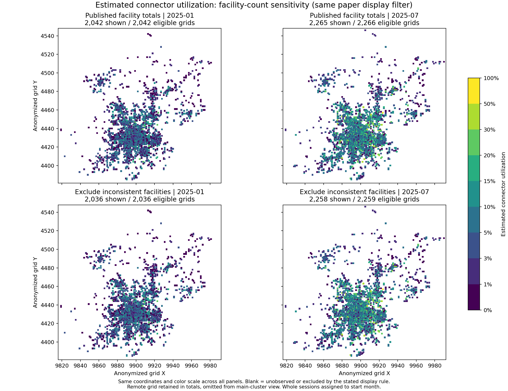

### 四、共同网格与共同站点冬夏比较（2张）

**13. 网格利用率配对散点图**：横轴1月、纵轴7月，对角线上方表示7月更高。上排统一0%—60%覆盖全部点，下排统一0%—25%放大并标明视窗内外数量；各列分别控制网格或站点范围。详见[标尺核查](reports/chart_scale_review.md)。

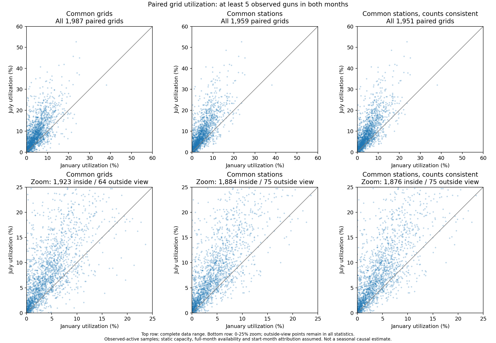

**14. 不同样本范围的比较**：比较全部观测站点、共同网格、共同站点和计数一致共同站点的汇总利用率及每枪日均订单。

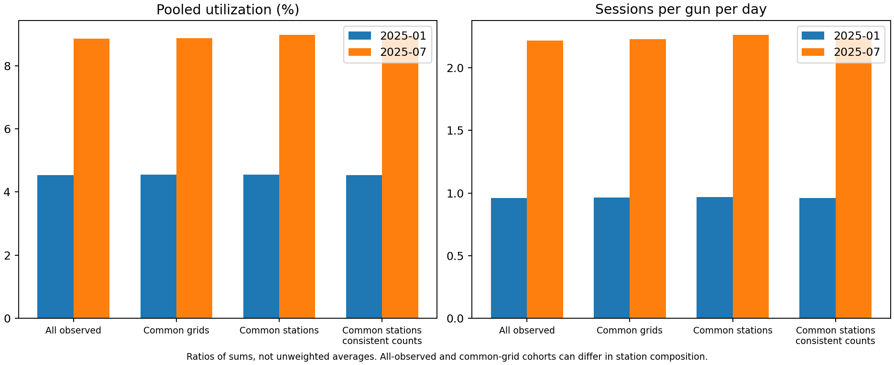

### 五、自然月时长与扩展分析（4张）

**15. 自然月拆分与开始月归属对照**：固定共同站点容量，比较两种时间归属方式及逐网格变化。

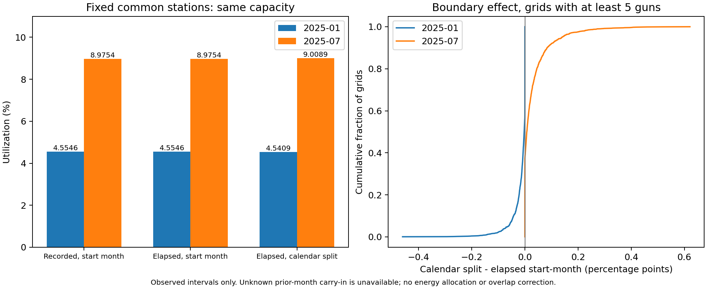

**16. 月界时长流入流出**：展示现有跨月会话在相邻月份之间转移的会话小时数，不代表完整的相邻月活动。

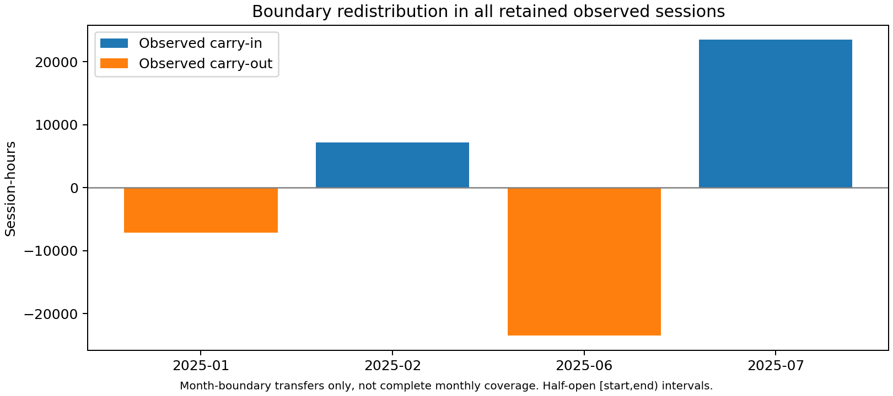

**17. 星期×小时到达热图**：固定共同站点，按对应星期的天数和枪数标准化；两个月共用色标，未单独识别法定节假日和调休。

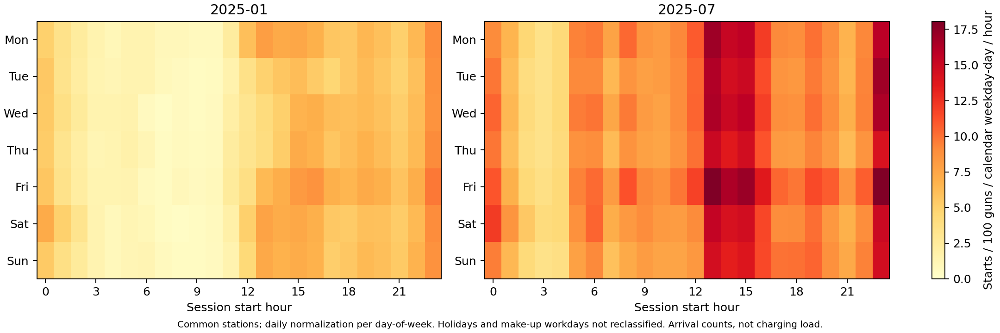

**18. 网格集中度曲线**：比较固定共同站点网格的枪数、订单和电量集中程度，各变量单独排序。

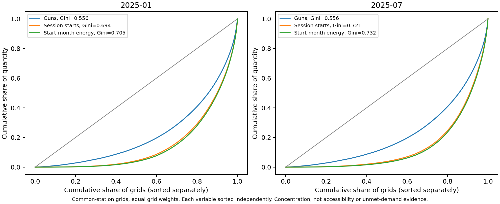

自然月对照只拆分会话时长，不分摊电量或费用。1月文件可延续至2月，7月文件结束却止于7月底，且相邻月份边界会话未必完整，因此当前不是严格完整自然月利用率。星期×小时热图表示到达次数，不是电力负荷；Lorenz曲线描述网格集中程度，不代表人口公平性。

### 六、共同网格差值与订单增量（6张）

差值统一为 **2025 年 7 月减 1 月**。图 19–22 使用两个月都有清洗后订单的 **2,239 个网格**。三张地图以红色表示增加、蓝色表示减少，接近白色表示变化较小；空白处在配对样本之外。坐标为匿名网格编码，颜色使用对称对数尺度，读数以各图色标为准。

**19. 订单量差值地图**。色标单位为笔，显示各网格多了或少了多少订单。共有 1,995 个网格订单增加，`9897_4437` 增量最大（+48,313 笔）。

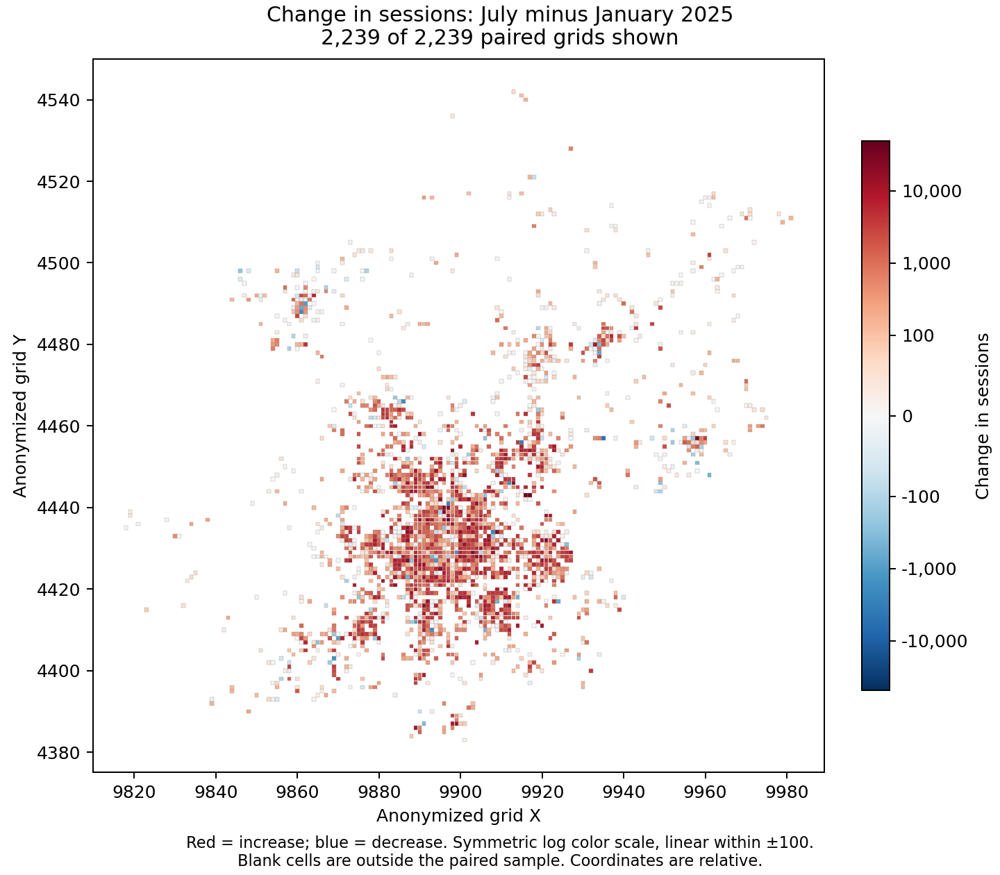

**20. 利用率差值地图**。色标单位为百分点，例如利用率从 8% 到 12% 对应 +4 个百分点。共有 1,838 个网格利用率提高。同一网格两个月纳入统计的站点可能不同。

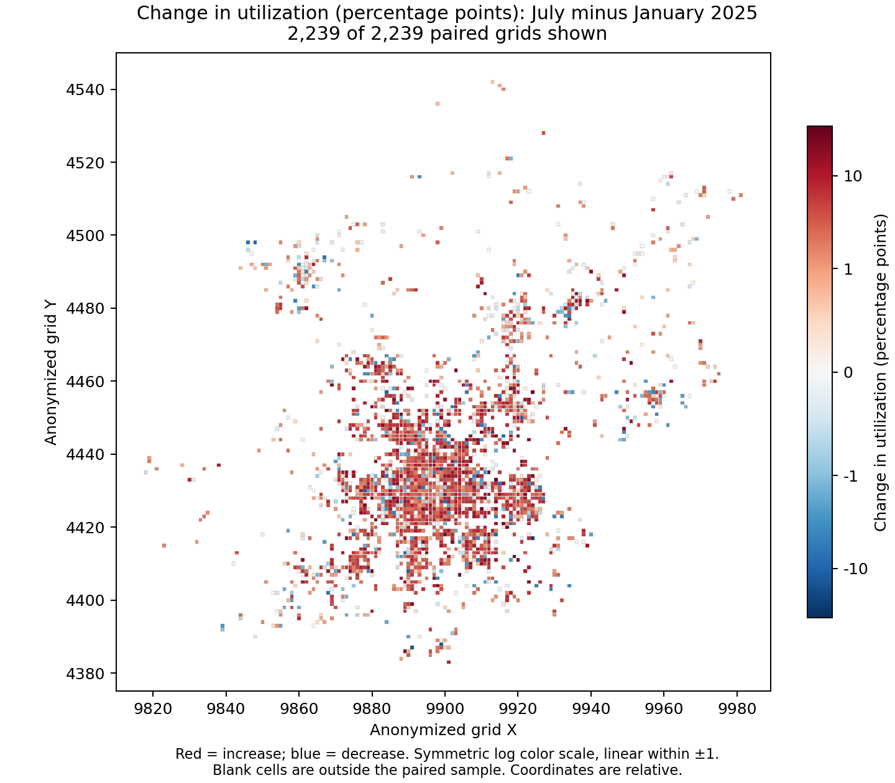

**21. 订单量与利用率变化散点图**。横轴是订单量差值，纵轴是利用率差值；每个点代表一个网格。右上角是两项都增加的 1,791 个网格，右下角紫色点是订单增加但利用率下降的 204 个网格。横轴在零附近为线性，远离零后按对称对数尺度显示。[查看首页散点图](reports/figures/source_release2/20261104T011749595890Z/grid_changes/03-orders-vs-utilization-change.png)

**22. 总充电量差值地图**。色标单位为 kWh，显示网格两个月的总充电量变化。1,958 个网格电量增加，逐网格变化的中位数为 +6,520.6 kWh。

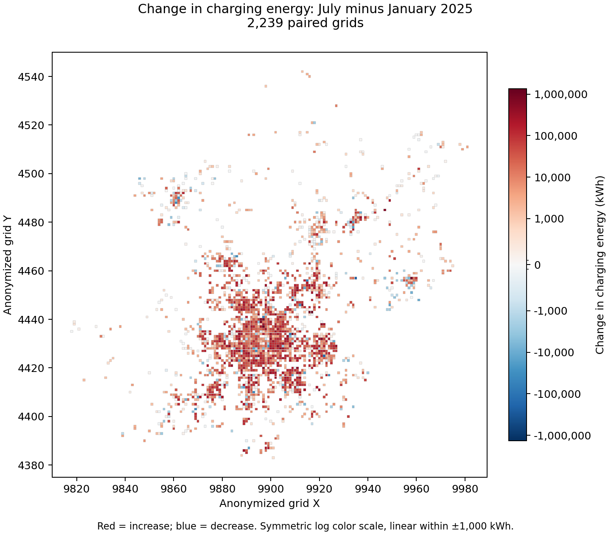

**23. 共同站点逐小时订单增量图**。固定 5,661 个共同站点，按会话开始小时统计订单增量。每根柱子表示该小时段在两个月的总订单差值，13 时增量最大（+209,453 笔）。

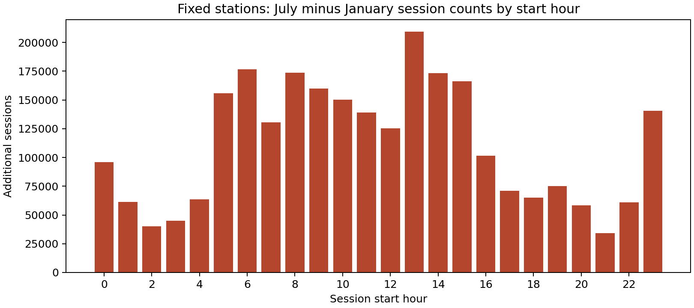

**24. 典型网格订单开始时段对照图**。五个面板各代表一个典型网格，曲线显示每小时订单占该网格当月订单的比例。例如，`9889_4413` 的占比峰值从 1 月 23 时移到 7 月 13 时。案例采用各月观测站点，固定站点和设备计数敏感性对照见报告。

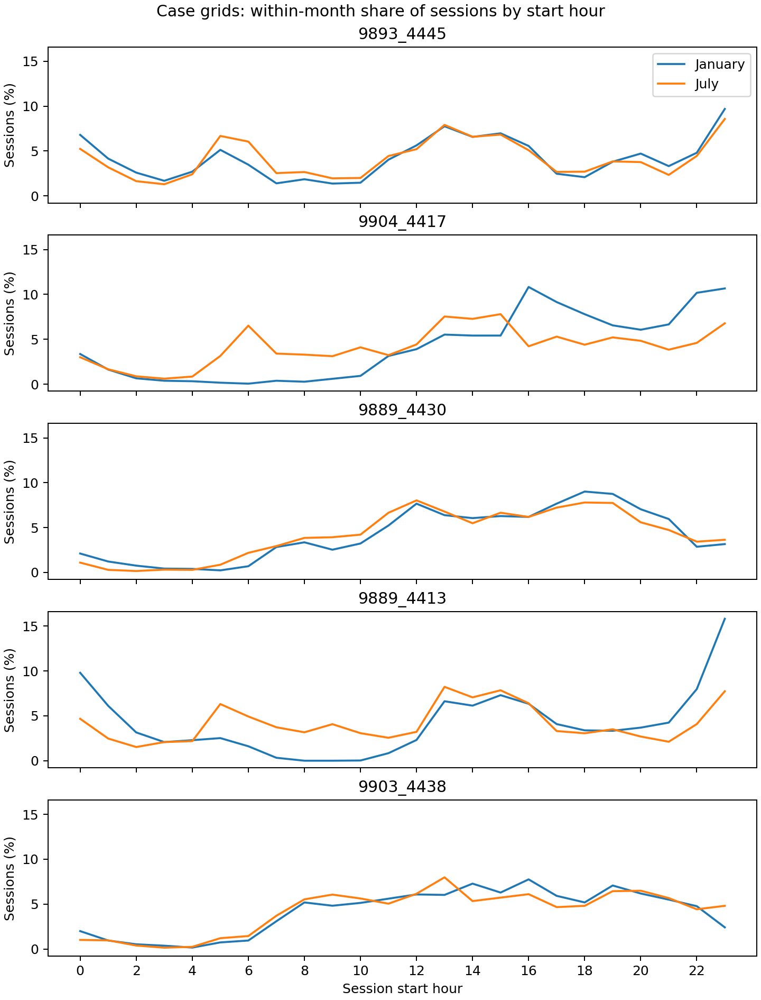

[完整分析报告及日期、场所分组结果](reports/grid_followup.md)

### 七、下一批图表（待绘制）

1. **利用率变化方向对照图**：横轴为按各月有订单站点计算的利用率差值，纵轴为固定共同站点后的差值，突出标记方向反转的 135 个网格。
2. **典型网格利用率变化分解图**：对比 `9893_4445` 和 `9904_4417` 两个月的订单量、单次平均记录时长和枪数，解释固定站点后两例为何表现不同。
3. **共同站点场所订单增量图**：按场所的订单净增量排序，展示“其他”及各明确命名类别的贡献。

## 目录

```text
data/raw/          旧发布版原文件，仅保留用于版本核验
data/redownloaded/ 发布版Version 2原文件，不上传
data/processed/    新版清洗与自然月派生数据，不上传
reports/           新版审计、分析和说明
reports/figures/source_release2/ 新版图表
deliverables/      新版汇报PPT
src/               分析代码，包含新版仍使用的通用绘图函数
tests/             分析校验
translations/      本地论文译稿，不上传
```

早期清洗脚本和校验保留作为实现历史，不是当前分析入口。正式流程以上述发布版Version 2命令为准。
