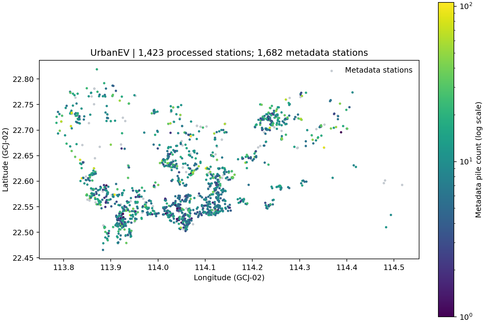
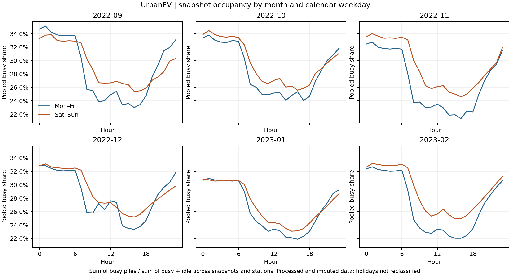

# 深圳 UrbanEV 首轮核查

已解压本地两个压缩包，原文件位于 `data/raw/UrbanEV数据/`。本次全量检查的是发布方提供的处理后站点序列。

| 检查项 | 结果 |
| --- | ---: |
| 站点属性记录 | 1,682 |
| 处理后站点 CSV | 1,423 |
| 序列总行数 | 74,178,144 |
| 每站时间点 | 52,128 |
| 缺失单元格、重复时间戳 | 均为 0 |
| 非 5 分钟相邻间隔 | 0 |
| 时间轴不完整的站点 | 0 |
| 忙闲负值、总数与快慢充分项不一致 | 均为 0 |
| 无法关联属性表的站点文件 | 0 |

每站覆盖2022年9月1日00:00至2023年2月28日23:55。属性表的 `station_id` 唯一，经纬度无缺失。论文最终区域样本包含1,362个站点，本次处理后站点文件为1,423个，属于不同筛选层级，不能混用规模。

## 字段与后续分析

- `busy`、`idle` 支持计算每个时间点的占用率 `busy / (busy + idle)`，零分母需要单独核查。
- `fast_busy`、`fast_idle`、`slow_busy`、`slow_idle` 支持快慢充对比。
- `e_price`、`s_price` 提供收费信息，单位应结合发布说明继续核对。
- `station_information.csv` 提供经纬度、快慢充数量、总数量和交通小区编号。作者说明站点坐标采用GCJ-02。
- `volume` 属于由状态和功率推算的量，与北京订单中的记录电量含义不同。北京交易时长利用率和深圳时点占用率也需要明确口径。

下一步核对忙闲总数随时间变化、零分母、价格和推算电量的范围，再绘制站点空间分布和工作日、周末日内占用曲线。现有时间轴完整性来自已填补、处理后的数据，无法据此推断原始采集无缺失。

复现命令为 `python src/inspect_urbanev.py`。机器可读核查结果位于本地 `data/processed/urbanev_audit/summary.json`。

## 第二轮核查与图表

运行 `python src/analyze_urbanev.py` 完成1,423个站点的设备和数值范围核查。所有时点的 `busy + idle` 均大于零，各站总数始终不变，并与属性表 `charge_count` 一致。电价和服务费无负值。

发现 **11,935行的duration或volume为负**，约占全部行的0.016%。duration范围为−65.25至22.0833，volume为−2,270至1,036。这些数值来自发布方的处理后文件，尚未修正。电价字段范围0.23–2.80，服务费0–1.45；价格单位仍需结合数据说明核对。时长和电量的负值原因及涉及站点需另查。

### 深圳站点空间分布

**字段与计算。** 根据站点CSV文件名匹配属性表的station_id，以longitude、latitude作坐标，charge_count映射对数色标。灰点为完整属性表的站点，彩色点为处理后序列覆盖的站点。

**读图结论。** 站点在城市空间上形成多个密集簇，色彩表示设备规模。坐标采用作者声明的GCJ-02，叠加其他地图前应核对坐标系。此图尚未叠加行政边界，不能仅凭位置指认区县或评估服务公平性。

### 分月、自然星期的日内占用率

**字段与计算。** 从time取月份、小时和自然星期，按月、周一至周五或周六至周日、小时分组。每组所有站点和5分钟快照的busy之和，除以busy与idle合计。即按设备规模与观测时点汇总的占用比例。每个月两类日期共用纵轴。节假日及调休尚未重新分类。

**读图结论。** 六个月均有夜间占用较高、白天下降、晚间回升的形态。2023年1月整月汇总占用率约26.64%，在六个月中最低；9月、10月约28.92%，11月27.46%，12月28.64%，2月27.64%。这些是处理后固定样本站点的描述，尚不能单独归因于温度或春节。

本图只使用忙闲状态，不使用存在负值的duration和volume。与北京的交易时长利用率比较前，还需要统一采样、时间窗口和占用定义。深圳状态快照包含填补值，夜间busy也需核对其是否代表实际充电或连接占用。
