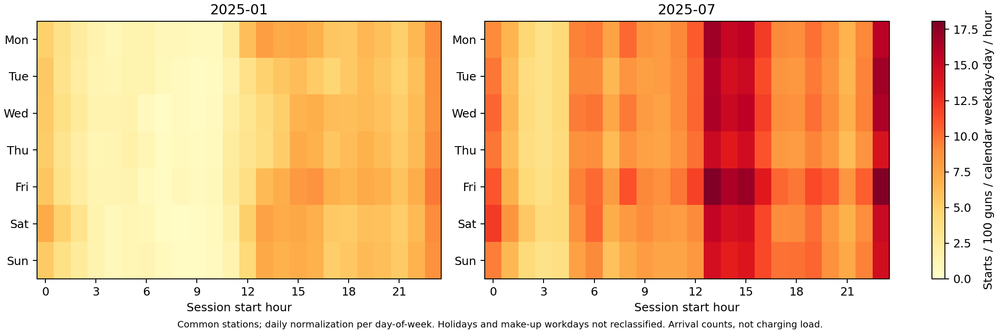
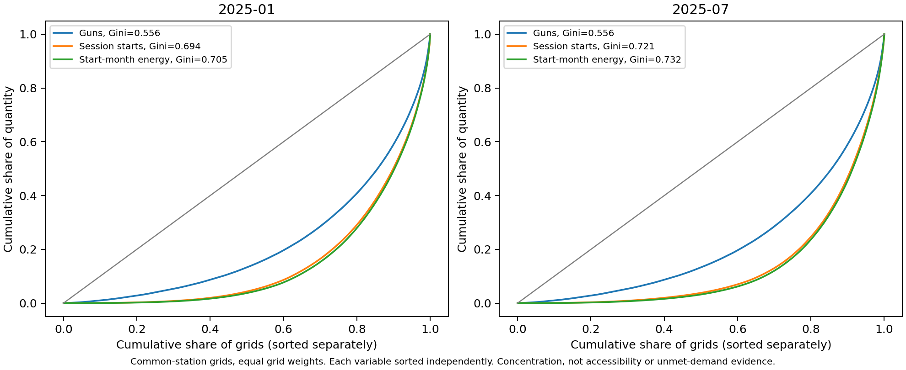

# 文献参考与可视化扩展方案

## 建议的分析主线

当前选题适合从“哪些网格不同”推进到“差异在什么时间、什么场所出现，是否由少数站点主导”。优先增加时间结构、场所分组和分布集中程度的比较，再考虑聚类。每一步继续使用共同站点，统一两月筛选规则，保留低样本数量和设施计数敏感性说明。

## 两篇原文能提供什么

### 北京充电数据论文

本地原PDF第14—17页的图2展示设施数量、功率、直流比例、单次电量和利用率的空间分布，平均电量与利用率分别设订单数和枪数门槛。第17—21页的图3—6比较不同场景的到达／离开时间、平均时长、到离时间密度和估计充电后停留。第21—24页的图7—8讨论费用占比、平均价格与电量、分时活动曲线。

适合借鉴的是“相同场所类型下比较两个月”，以及同时展示分布形状和样本规模。论文用电量／功率／假定效率估计有效充电时间，实际数据只有额定功率，不能把这类估计当真实充电完成时间。本项目暂不将其命名为实测占位或实测柔性潜力。现有自然月交集拆分也是本项目补充的口径对照，并非原文明确给出的拆分方案。

### 共享单车与公共交通论文

本地原PDF第4页的第3.4节区分公交／地铁场景、工作日／周末，使用多源建成环境变量并检查共线性；第5页表3比较OLS与MGWR，第6—8页讨论局部系数的空间差异。该文利用真实交通站点位置与周边缓冲区构造解释变量。

可以借鉴“先分场景，再比较”和“整体均值可能掩盖局部差异”。当前匿名充电网格没有确认的真实地理对应，缺人口、道路、POI匹配数据，不能直接复用其1.5 km环境缓冲区或开展同等意义的建成环境MGWR解释。自然星期分类也不能直接称为法定工作日，中国节假日与调休需另外核验。

## 补充研究依据

1. Gellrich、Block与Leikert-Böhm（2022），*Spatial and temporal patterns of electric vehicle charging station utilization: a nationwide case study of Switzerland*，分析星期和小时的设施利用模式。可借鉴时段分组，但其实时状态数据与本项目会话到达记录不同，本次热图明确使用到达次数，而非复现其逐小时占用率。[机构资料与摘要](https://digitalcollection.zhaw.ch/entities/publication/b74cd6dc-49f8-4915-b22b-7a658311909e/full)，[DOI](https://doi.org/10.1088/2634-4505/ac6a09)。
2. Zhan等（2025），*Large-scale empirical study of electric vehicle usage patterns and charging infrastructure needs*，其图4呈现时序模式聚类及空间分布，提示可以区分时间形状不同的网格。其车辆级与功率资料比本项目丰富，因此这里只借鉴模式识别，不照搬行为解释。[原研究](https://www.nature.com/articles/s44333-024-00023-3)。
3. Wang、Oshanreh与Mackenzie（2026），*A hybrid temporal-spatial framework for understanding public EV charging usage patterns: Evidence from Bay Area*，以SOM时序分群结合空间模型讨论设施使用类型。摘要显示其数据为Google Popular Times，并结合社会经济和建成环境变量，和本项目交易表不同。这里只参考“时间类型与地理邻近可以分开研究”的思路，未执行其SOM和贝叶斯模型。[出版方摘要](https://www.sciencedirect.com/science/article/pii/S2210670725009229)，[DOI](https://doi.org/10.1016/j.scs.2025.107052)。

以上新增研究根据出版方或作者机构页面核验；部分全文页面访问受限，未声称逐项复现全文模型。网格Lorenz曲线是本项目补充的描述性工具，不声称来自上述两篇本地论文的原图。

## 优先做哪些图

| 顺序 | 图与分析 | 回答的问题 | 当前可行性与注意点 |
| --- | --- | --- | --- |
| 已补做 | 星期×小时到达热图 | 两个月的到达高峰集中在哪些星期和时刻？ | 共同站点，除以该月对应星期的天数和固定枪数，两月同色标。属于开始次数，不是电力负荷。 |
| 已补做 | 网格Lorenz曲线与Gini | 枪数、订单和电量是否集中于少数网格？ | 固定共同站点网格，每个变量单独排序。不表示居民公平性，也不能仅凭两条曲线的差异认定供需错配。 |
| 优先追加 | 场所分组的配对变化箱线图或小提琴图 | 1月到7月哪些场所的利用变化更大？ | 先在站点层配对，展示变化中位数、四分位和样本数。少量大站与大量小站分别看加权与不加权结果，避免只按订单权重掩盖站间差异。 |
| 优先追加 | 共同网格利用率变化图 | 哪些网格上升、哪些下降，变化是否集中？ | 用同一固定站点集的7月减1月，零点居中的发散色标，两月均达到枪数门槛，另标计数敏感网格。只作匿名相对位置图。 |
| 第二批 | 按场所的到达—离开时间密度图 | 短会话、夜间会话和跨日会话的结构有何区别？ | 可按论文图3—5制作小时分布、hexbin或时长分位曲线。到离钟点需要标明跨日，不能把23:00至次日01:00当负时长。 |
| 第二批 | 日期×小时活动日历图 | 月均曲线是否被少数日期主导？ | 先画每日记录到达次数，明确有数据日；核验法定节假日后再加春节和调休标记。不得仅从一月七月推断季节效应。 |
| 第二批 | 网格时间模式聚类与类型空间图 | 是否存在夜间型、白天型或双峰型网格？ | 按网格24小时到达分布归一化，避免聚类只区分总量大小。先筛最低样本，比较若干簇数、重复初始化稳定性和轮廓系数，暂不强行指定类别含义。 |
| 后续探索 | 单位电量费用与单次电量hexbin | 不同收费水平对应的会话结构是否不同？ | 电量>0时计算费用／电量，区分电费与服务费，控制场所和功率类别。比值与电量共享分母，且价格混合时段和用户选择，只能先作描述性关联。 |

## 对当前选题最有帮助的组合

汇报主图可用“共同站点利用率变化空间图＋场所分组变化分布＋星期小时热图”。空间图说明变化位置，分组图说明差异发生于什么场所，热图说明时间结构。Lorenz曲线作为补充，回答总体活动集中于少数网格还是广泛分布。

后续若要解释需求与设施配置，可以画固定网格的容量份额和活动份额关系，但应称“观察到的配置与活动差异”，避免使用“需求缺口”。同一份额、时长和利用率之间有数学关系，不将恒等关系当作独立机制证据。Moran's I、LISA及MGWR应等匿名坐标邻接关系和外部变量可用性确认后再考虑。

## 本轮输出口径

本轮另有[自然月对照报告](calendar_month_review.md)。其中自然月图使用时间戳区间交集，按月拆分时长，未分摊电量。热图和Lorenz中的订单量、电量仍采用开始月口径，这是不同问题的两种统计，不混称为全部指标都已自然月化。

本轮实际运行`20261104T075413371066Z`，对应图如下：

热图以固定共同站点的每100把枪、每个对应星期日、每小时开始次数为单位。深色代表该时段到达更密集；两个面板使用相同色标。不能将其解释为瞬时功率或占用率。

共同站点网格的枪数Gini为0.556，订单Gini由1月0.694变为7月0.721，电量Gini由0.705变为0.732。数值说明记录活动在网格间的集中程度高于枪数分布，且7月更集中。每种变量单独排序，曲线不说明高活动网格是否恰好是高容量网格，也不说明未满足需求或居民公平性。

最新数据运行、图片目录和跨月分段核对表见自然月报告，所有新文件均独立输出，旧版图表保留。
