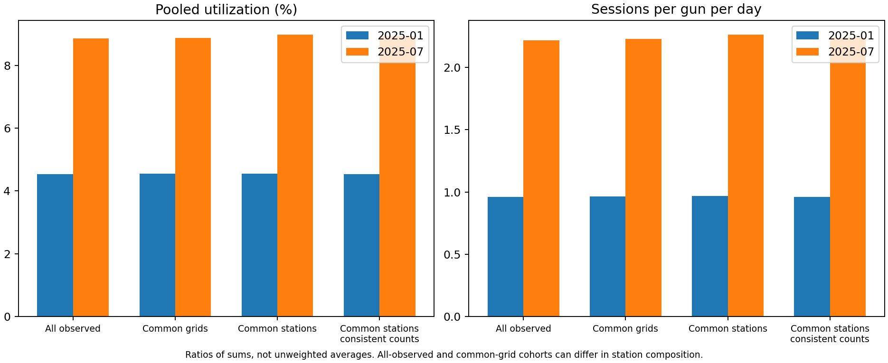
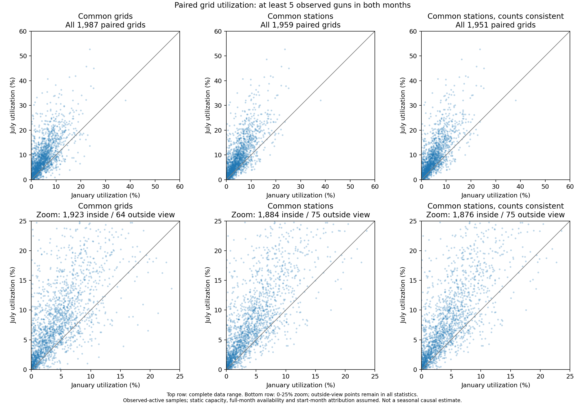

# 北京市公共充电设施需求与利用的网格差异

## 当前进展

本研究基于2025年1月和7月公开交易记录，比较匿名网格内已实现的充电活动及设施利用差异。发布方Version 2补充了站点关联键，因此本项目已经从同一批清洗订单重新计算站点和网格指标。共同站点比较表明，7月的活动强度与记录时长利用率高于1月；排除设施计数不一致站点后，这一总体方向保持。但个别网格对计数处理敏感，当前不能形成设施短缺、过剩或具体选址结论。

## 数据与版本

数据来自同一Figshare数据集的发布版Version 2。本地原始文件包括两个月订单和站点属性表。订单共8,544,695条，站点属性表8,553个唯一站点，所有订单均可通过station_id关联。旧发布版Version 1缺少关联键，旧图及“无法同步清洗网格月表”的说明仅属于历史版本。发布方Version 2与项目此前命名的“清洗v2”是不同概念。

当前清洗运行编号为`20261104T011749595890Z`。原始数据、旧版清洗文件和图表全部保留。处理清单与源文件哈希用于追溯，不直接修改原文件。

## 清洗与指标

1月排除20条联合极端值和1,179条设备类型或额定功率缺失记录，两类无重叠，共1,199条。7月没有这两类剔除。极端值规则为电量超过1,000 kWh且超过额定功率乘记录时长估算电量的105%，这是项目保守筛查规则，尚未完整复现论文的200 kWh公交例外和站点类型内Z分数规则。

订单整笔归入充电开始月份。13,493条6月30日开始的记录单独保留为6月部分样本，不计入7月，也不当完整6月。当前两月保留订单分别为2,136,035和6,393,968条，充电量分别约59.951与175.447 GWh。

网格订单量、电量和时长由站点记录加总。站点容量按每站每月一条属性计入，不随订单数重复累加。网格利用率等于网格记录会话时长之和除以总枪数、月份天数和每日1,440分钟，等价于按枪数加权的站点利用率。该指标假定静态容量和整月可用，不能替代实际有效充电功率利用率。

参考充电论文，平均单次电量图只展示至少5笔订单的网格，利用率图只展示至少5把枪的网格。两种条件分别实施，只影响对应展示或配对比较，不从原始文件删除。匿名网格只支持相对空间表达，不直接叠加真实行政区或道路。

## 冬夏比较结果

两个月共同观测网格2,239个，共同有订单站点5,661个。共同网格仍可能存在站点构成变化，因此同时设置共同站点对照。未观测站点不补零，样本范围明确限定为有保留订单的活跃站点。

| 样本范围 | 1月汇总利用率 | 7月汇总利用率 | 1月每枪日均订单 | 7月每枪日均订单 |
| --- | ---: | ---: | ---: | ---: |
| 全部观测站点 | 4.528% | 8.852% | 0.960 | 2.215 |
| 共同网格 | 4.545% | 8.874% | 0.966 | 2.227 |
| 共同站点 | 4.555% | 8.975% | 0.968 | 2.262 |
| 计数一致的共同站点 | 4.533% | 8.926% | 0.959 | 2.238 |

图1展示各组总时长与总枪时之比，以及总订单与总枪日之比。固定共同站点后，7月仍明显高于1月，说明全部样本的差异不能完全归因于观测站点范围扩大。

在共同站点样本中，对两月均至少5把枪的1,959个网格进行配对，7月减1月利用率变化的中位数为2.272个百分点，85.04%的网格上升。排除设施计数不一致站点后，1,951个配对网格的变化中位数为2.267个百分点，85.03%上升。配对变化中位数与上表汇总利用率是不同统计量，不可混用。

图2横轴为1月、纵轴为7月，相同利用率位于对角线。对角线上方表示7月利用率更高，各面板均要求两月达到枪数门槛，分别固定网格、固定站点或固定计数一致站点。

## 设施计数核查

原始属性中41个站点的总桩数与直流、交流分项和不一致，42个站点的总枪数与分项和不一致。两组有重叠，不把两个数字相加当独立问题站点数。基准分析保留总数并标记，敏感性分析排除相关站点，同时移除其订单时长和容量。

局部核查发现，7月网格9885_4425排除ST_000828后利用率从20.648%降至4.757%，变化约15.891个百分点；1月网格9896_4425排除相关站点后反而上升约10.102个百分点。移除站点同时改变分子时长与分母枪数，因此两种变化方向均可能出现。该对照只能说明局部结果依赖处理选择，不能辨认总数或分项哪一项正确。逐网格清单见[比较报告](winter_summer_comparison.md)，筛选及敏感性图见[对应报告](release_v2_filters_sensitivity.md)。

## 文献依据与自行补充的处理

充电数据论文提供时间一致性检查、物理范围、缺失值、重复记录与分组异常检查，以及网格指标和低样本展示方法。实际发布文件仍保留与论文筛查描述不完全一致的记录；论文正文与表格剔除数量也存在差异。因此本项目逐条记录已实施规则，避免将自己的阈值写成作者规则。公开文件不提供唯一交易标识，不能把pile_id当交易ID直接去重。

共享单车与公交论文提供按行为或日期分组比较、讨论空间异质性和代理变量局限的研究思路，但其缓冲区匹配与回归方法不能直接解决充电设施计数或会话占用问题。共同站点对照和设施计数排除是本项目针对覆盖差异与属性问题补充的稳健性检验，不宣称直接照搬这两篇论文。

## 尚需完成

| 事项 | 当前状态 | 下一步及判断依据 |
| --- | --- | --- |
| 设施总分项不一致 | 已标记、已对照、已定位敏感网格 | 核实字段口径，不能凭对照擅自改原值 |
| 静态容量与整月可用 | 已明确假设，未校正 | 检查是否存在开放或停机信息，缺资料时保留限制 |
| 会话重叠 | 尚未做站点／桩时间区间审计 | 区分多枪共享桩与重复记录，不直接认定重叠等于重复 |
| 自然月占用时长 | 当前整笔归开始月 | 可追加按月界切分时长的对照；电量不按时间比例冒充实测分配 |
| 论文完整清洗复现 | 当前保守清洗＋论文展示门槛 | 如追加200 kWh与分组Z分数方案，应单独输出，不覆盖基准 |
| 季节、价格与节假日解释 | 当前仅描述差异 | 缺更多月份与控制变量，暂不作因果判断 |
| 课程正式提交包 | 阶段PPT、讲稿与分析已更新 | 仍需正式报告、真实周报合并、演示视频及提交打包 |

课程要求中的正式总结需按小组或个人字数、摘要、图编号与正文引用要求整理；项目代码包和视频另有大小限制。本文为阶段分析底稿，不冒充已完成正式课程报告，也不补造历史周报或个人贡献。原始数据、译稿与大体积中间数据不纳入代码提交包。

## 输出索引

- [版本核验与重启说明](release_v2_restart.md)
- [本轮清洗与重建清单](source_release2_clean1_20261104T011749595890Z.json)
- [论文展示门槛与计数敏感性](release_v2_filters_sensitivity.md)
- [冬夏配对与局部敏感网格清单](winter_summer_comparison.md)
- [逐页讲稿](新版数据_五分钟逐页讲稿.md)
- [新版阶段PPT](../deliverables/北京充电数据分析_新版数据与冬夏比较_1104修订版.pptx)

本地译稿Markdown的旧版核查注已经注明版本，并将移列的DOI标为译者补充。译稿PDF尚未重新导出，仍为历史版本；译稿及其图表继续不上传仓库。
